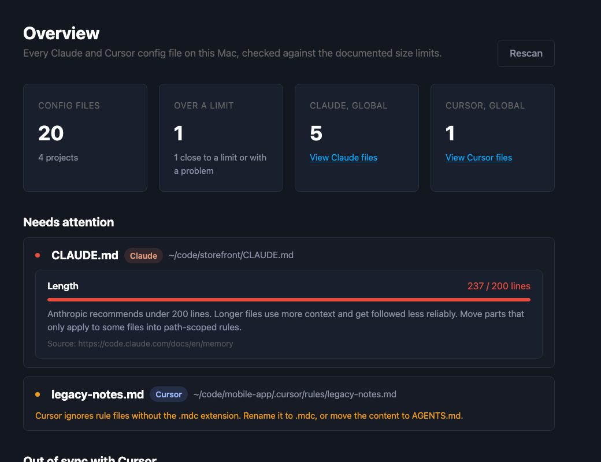
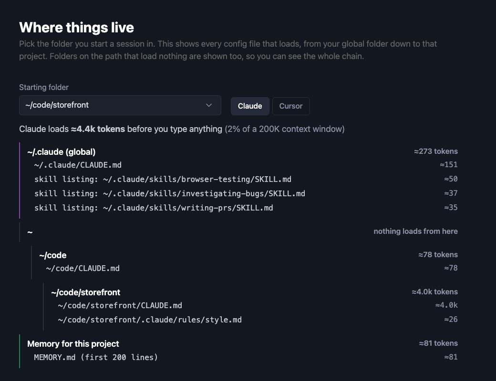
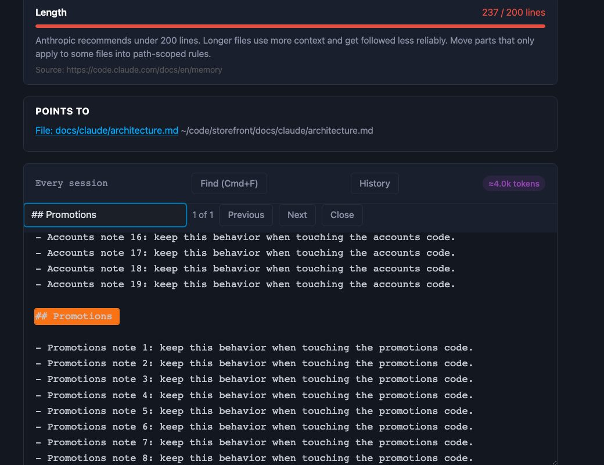
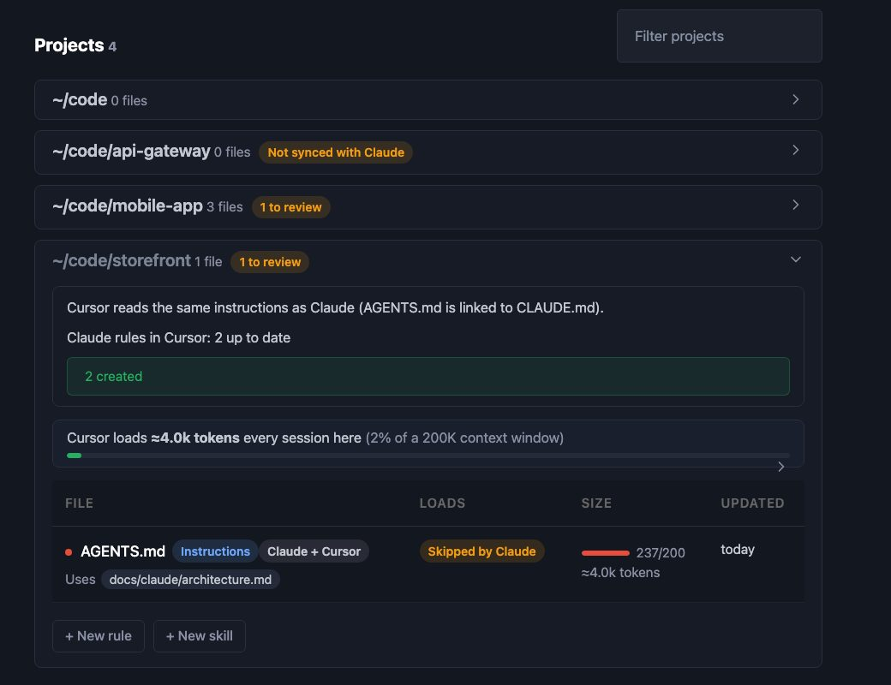
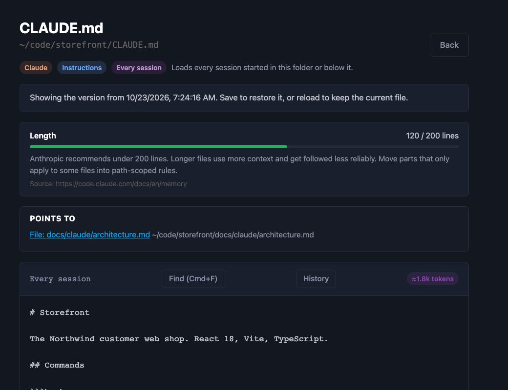

# Hippo

A small macOS app that finds every Claude Code and Cursor config file under your home folder, so you can read, edit and add them in one place, and see when they're getting too big to be useful.

The name is short for hippocampus, the part of the brain that stores memories. Claude and Cursor start every session with no memory of the last one, except what their config files tell them. Hippo is the one place to see and fix all of it.

- **Claude:** `CLAUDE.md` files, `.claude/rules`, skills, `settings.json`, and Claude's saved memory.
- **Cursor:** `.cursor/rules` (`.mdc`), skills, and `.cursorrules`.
- **Both:** `AGENTS.md`.
- **Size gauges** use the limits from each tool's own docs, for example: `CLAUDE.md` under 200 lines, only the first 200 lines of `MEMORY.md` load, Cursor rules held to the same 200 lines.
- **Every-session total** per project: roughly how many tokens Claude reads before you type anything.
- **Skills page** with every Claude and Cursor skill, its size, and which configs point to it. Editors show what a file points to and what uses it.
- **Cursor follows Claude:** one click links a project's `AGENTS.md` to its `CLAUDE.md`, and mirrors `.claude/rules` into `.cursor/rules` (`.mdc`). Mirrored files are marked, so Hippo never touches Cursor rules you wrote yourself.
- **Alerts:** a macOS notification when a file crosses a limit or a project falls out of sync with Cursor, plus at most one daily summary while something needs attention. The menu bar icon shows the count.
- **Reference docs** in any `docs/claude/` folder show up and can be edited, so big CLAUDE.md files can point to them instead of holding everything.

Everything stays on your machine. Hippo makes no network requests.

## How it works

The screenshots below use a made-up company, Northwind, so they show nothing real. The same walkthroughs are in the app under **How it works**, with numbered callouts on each screen.

**Find what needs attention.** Overview lists every file over or close to its limit, with the reason and where the limit comes from.



**See what loads before you type.** Pick the folder you start a session in. Hippo shows every file Claude (or Cursor) reads, from your global folder down to the project, and roughly how many tokens that costs.



**Trim a file that's too long.** Find the section that only matters for some files, move it into a rule with `paths:`, and the gauge goes green.



**Keep Cursor in step with Claude.** One click links `AGENTS.md` to `CLAUDE.md` and mirrors `.claude/rules` into `.cursor/rules`.



**Undo a bad edit.** Every save keeps the version before it. Load one, read it, and save to restore it.



### Try it without your own files

```bash
npm run demo        # builds the fake Northwind home and its snapshot (needs Rust)
npx vite --port 5174
```

Then open `http://localhost:5174/demo/index.html`. `npm run screenshots` retakes every How it works screenshot from that demo, so they never show your real files.

## Install

You need macOS, [Node.js](https://nodejs.org) 18 or newer, and [Rust](https://rustup.rs).

```bash
git clone https://github.com/gregdbanks/hippo.git
cd hippo
npm install
npm run build
```

The build copies `Hippo.app` to your Desktop. To put it somewhere else:

```bash
HIPPO_INSTALL_DIR=/Applications npm run build
```

Turn on "Open Hippo at login" on the Overview page if you want alerts after a restart. macOS asks once to allow notifications.

The first launch can take a few seconds. If some of your projects live in Desktop or Documents, macOS asks whether Hippo can read those folders. Allow it to include them, or decline and they're skipped.

## What it can change

Hippo only saves Claude and Cursor config files inside your home folder. It warns before overwriting a file that changed on disk since you opened it, and it won't save a settings file that isn't valid JSON. New rules and skills are created from a template and never overwrite an existing file.

## Development

```bash
npm run dev          # app with hot reload
npm test             # frontend unit tests
npm run typecheck
cd src-tauri && cargo test --lib   # backend tests
```
